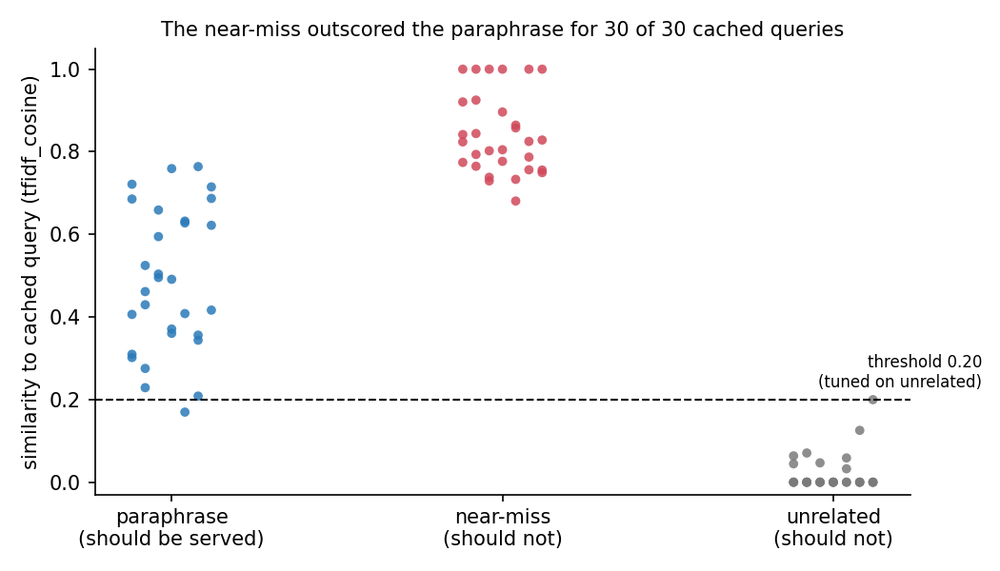

# Semantic cache thresholds vs. near-miss queries

LLM apps often put a **similarity cache** in front of the model: if a new
question is "close enough" to one already answered, return the stored answer
and skip the API call. The whole design rests on one number, the similarity
threshold, and that threshold is usually tuned by checking that *unrelated*
questions stay below it.

This repo asks what that tuning misses. It scores 30 cached questions against
three kinds of incoming question:

- a **paraphrase** that should get the cached answer ("How many kilometers is
  50 miles?" for "Convert 50 miles to kilometers"),
- a **near-miss** that looks almost the same but needs a different answer
  ("Convert 15 miles to kilometers"), and
- an **unrelated** question, the kind of negative a threshold is usually
  tuned against.

## Headline finding

**Tuned against unrelated questions, a word-overlap cache looks close to
perfect. Against near-miss questions, the same scores point the wrong way:
every near-miss outscored its own paraphrase, for all 30 cached questions.**

| similarity measure | AUC vs. unrelated | AUC vs. near-miss | threshold tuned on unrelated | paraphrases served | near-misses served (wrong answer) |
|---|---:|---:|---:|---:|---:|
| TF-IDF cosine | 0.999 | 0.020 | 0.20 | 29/30 (96.7%) | **30/30** |
| TF-IDF cosine + word pairs | 0.998 | 0.004 | 0.15 | 26/30 (86.7%) | **30/30** |
| word-set Jaccard | 0.989 | 0.002 | 0.25 | 21/30 (70.0%) | **30/30** |

AUC is the probability that a paraphrase scores higher than a negative (1.0 =
perfectly separable, 0.5 = no signal, below 0.5 = backwards). "Threshold tuned
on unrelated" is the lowest threshold on a 0.05 grid at which none of the 30
unrelated questions would be served.



What the numbers say:

- **No threshold fixes it.** With TF-IDF cosine, raising the threshold drops
  paraphrases faster than near-misses: at 0.50 the cache serves 13/30
  paraphrases and still 30/30 near-misses; at 0.80 it serves no paraphrases
  and 18/30 near-misses.
- **Role swaps can never be separated by a word-bag score.** "Convert US
  dollars to euros" and "Convert euros to US dollars" contain the same words,
  so all 6 role-swap near-misses score exactly 1.0. Even a threshold of 1.0
  serves them.
- **Making the score order-aware does not rescue it.** Adding adjacent word
  pairs pushes role swaps below 1.0, but it pushes paraphrases down even
  further (the near-miss still wins 30/30). The only threshold that stops every
  near-miss (0.85) serves zero paraphrases.
- **A cheap rule-based guard fixes two of the five failure types.** Refusing
  reuse when the two questions mention different numbers or differ in
  negation ("not", "don't", "without", "no") blocks all 12 number and negation
  near-misses, blocks none of the 30 paraphrases, and does nothing for role
  swaps, entity swaps (Austria vs. Australia) or antonyms (zoom in vs. zoom out).
  With TF-IDF at 0.20 plus the guard, the cache still serves 18/30 near-misses.

The per-anchor result (near-miss above paraphrase in 30 of 30) gives an exact
sign-test p of about 2e-9, but the bigger caveat is about construction, not
chance; see the first limitation below.

**Takeaway:** a cache threshold validated only on unrelated questions has not
been validated. The test set needs hard negatives: questions one or two words
away from a cached one that need a different answer.

## Setup and run

The experiment uses only the Python standard library. `matplotlib` draws the
figure and `pytest` runs the tests. No API key or network access is needed.

```bash
python3 -m venv .venv
.venv/bin/python -m pip install -r requirements.txt

.venv/bin/python scripts/run_experiment.py            # prints every table and number in this README
.venv/bin/python scripts/run_experiment.py --figure   # also redraws docs/similarity_by_query_kind.png
.venv/bin/python scripts/run_experiment.py --save     # also writes outputs/results.json (every per-query score)
.venv/bin/python -m pytest -q                         # 51 tests
```

Everything is deterministic. Every number in this README is asserted by
`tests/test_reported_numbers.py`, so the docs cannot silently drift from the
code.

### Optional: rerun it with a real embedding model

Production semantic caches compare embeddings, not word overlap. To run the
same analysis on OpenAI embeddings:

```bash
.venv/bin/python -m pip install openai==1.109.1
OPENAI_API_KEY=... .venv/bin/python scripts/run_embedding_eval.py --model text-embedding-3-small
```

This sends the 90 distinct questions in a single embeddings request. **It has
not been run for this README, and no embedding numbers are reported here.**
The tests exercise this path with a fake embedder, so CI never needs a key.

## Data

`data/query_triples.json` holds 30 triples written for this repo: a cached
question, its paraphrase, and its near-miss. There are 6 triples for each of
five near-miss types:

| type | example cached question | example near-miss |
|---|---|---|
| number | Set a timer for 10 minutes | Set a timer for 30 minutes |
| negation | Which cereals contain gluten? | Which cereals do not contain gluten? |
| role swap | Flights from Boston to Denver on Friday | Flights from Denver to Boston on Friday |
| entity | What is the capital of Austria? | What is the capital of Australia? |
| antonym | How do I zoom in on a map? | How do I zoom out on a map? |

The **unrelated** question for cached question *i* is the paraphrase of
question *i + 15* (wrapping around), so it always comes from a different
near-miss type and usually a different topic. The data was frozen before the
first experiment run.

## How it works

```
cache_eval/
  dataset.py     # load and validate the triples
  similarity.py  # tokenizer, Jaccard, TF-IDF cosine (optionally with word pairs); no dependencies
  guard.py       # the number/negation guard
  metrics.py     # served rate, ROC AUC, threshold tuning, exact sign test
  experiment.py  # scoring, summaries and the text report
  plot.py        # the README figure
  embeddings.py  # OPTIONAL: OpenAI embedding similarity
scripts/
  run_experiment.py     # the offline experiment
  run_embedding_eval.py # the optional real-embedding check
tests/                  # unit tests per module, pinned README numbers, smoke tests
```

1. Each incoming question is scored against its cached question with one
   similarity measure.
2. The cache "serves" the stored answer when `similarity >= threshold`.
3. Serving a paraphrase is a correct hit. Serving a near-miss or an unrelated
   question returns someone else's answer.
4. The threshold is tuned the common way (raise it until no unrelated question
   gets through) and then checked against the near-misses.

## Limitations (read these before quoting a number)

- **The lexical result is close to guaranteed by construction.** A near-miss
  is, by definition, a one- or two-word edit of the cached question, while a
  paraphrase rewords it. Any word-overlap score will rate the edit as more
  similar. The point of this repo is not that word overlap fails; it is how
  completely an easy-negative evaluation hides that failure (AUC 0.999 vs.
  0.020 on the same scores), and which failure types a cheap guard can and
  cannot fix. Whether *embedding* caches show the same inversion is the open
  question, and the optional script is there to test it.
- **30 hand-written triples, written by one person.** The paraphrases vary in
  how much they reword, and that choice moves the paraphrase hit rates. The
  near-miss types are ones I chose because they change the correct answer; a
  real query log would have a different mix.
- **The tuned threshold sits on an edge.** At TF-IDF 0.20 the closest
  unrelated pair scores 0.1999 ("How do I enable two-factor authentication?"
  vs. "How many euros do I get for a US dollar?", which share only "how", "do"
  and "i"). A finer grid or a different unrelated pairing would move the tuned
  threshold slightly. The near-miss result does not depend on it: near-misses
  are served at every threshold up to 0.65.
- **IDF weights are fitted on the 90 test questions.** A real cache would fit
  them on its own traffic. With only 90 short documents, IDF values are noisy.
- **The guard is a sketch.** It reads digits and the number words one to
  twelve, and a fixed list of negation words. It would miss "a dozen", "half",
  or negation by implication ("gluten-free").

## License

MIT. See [LICENSE](LICENSE).
